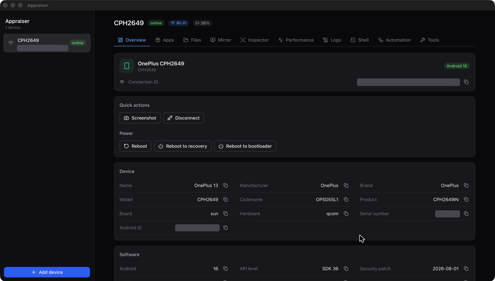
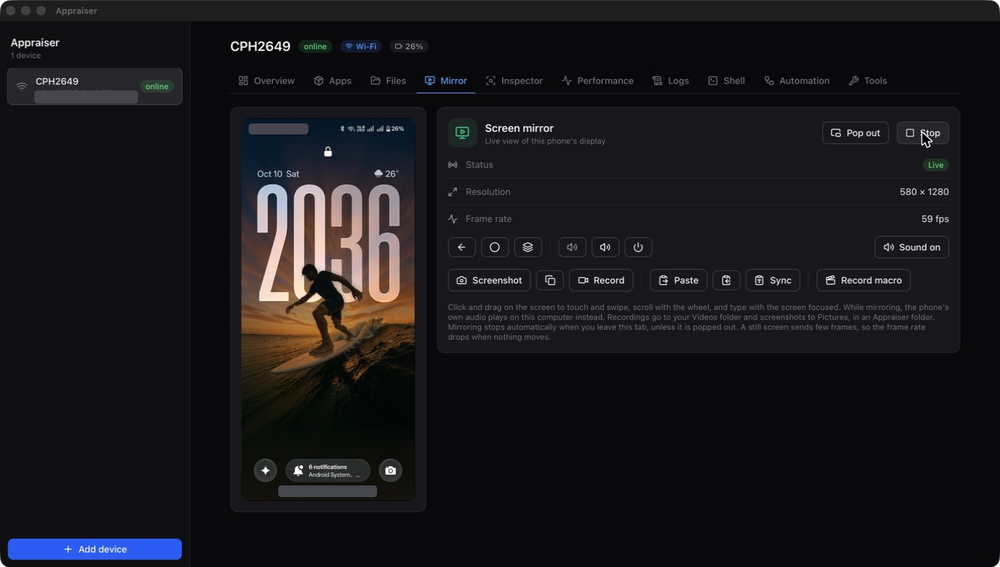
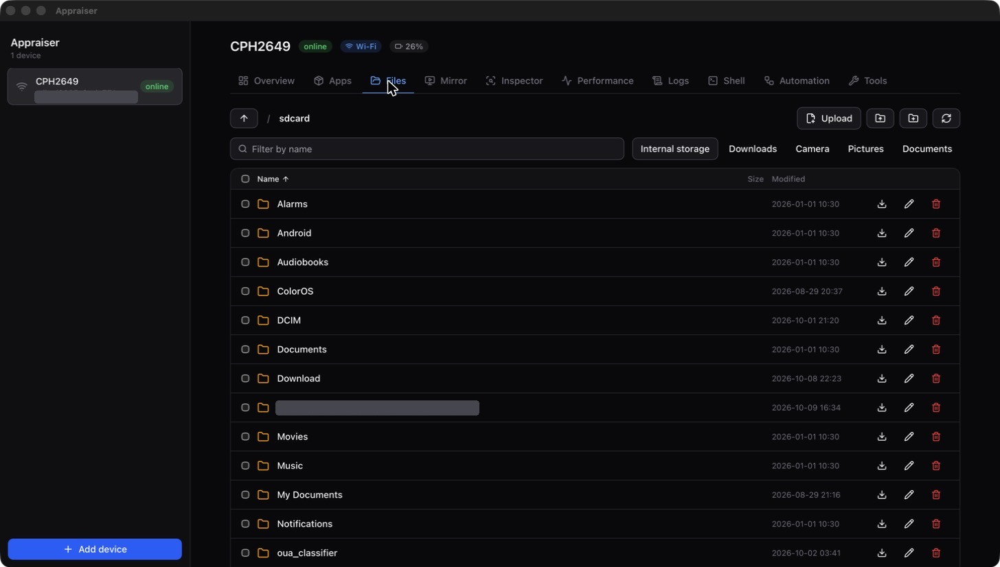
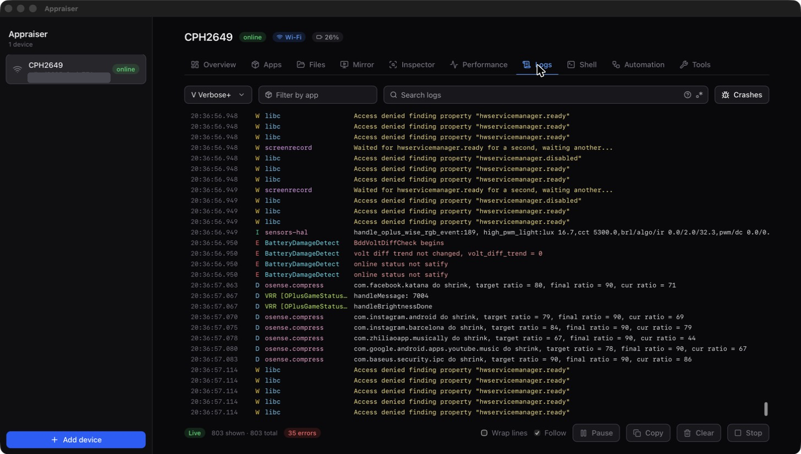

<p align="center"></p>

# Appraiser

A visual manager for adb-connected Android devices, built with Tauri 2 (Rust) and React + TypeScript.
Runs on macOS, Windows and Linux. `adb` is bundled, so there is nothing else to install.

[**Download**](https://github.com/CSWanigasooriya/appraiser/releases/latest) · [Website](https://cswanigasooriya.github.io/appraiser/)

<p align="center">
  
  
  
  
</p>

## Features
- Overview, apps (with permissions, storage, APK extraction), file browser, logs and shell.
- Screen mirroring with touch, sound, screenshots, screen recording (with sound), clipboard sync and macro recording.
- UI inspector, live performance charts, and a Tools tab: intent tester, developer settings, network and port forwarding, battery simulation and one-click bug reports.
- Automation: saved shell commands and replayable macros. "All devices" runs installs, commands and switches on every phone at once.
- Wireless devices are remembered and reconnected automatically.

## Install
Grab the installer for your OS from the [latest release](https://github.com/CSWanigasooriya/appraiser/releases/latest).
Builds are not code signed yet: on macOS right-click the app and choose Open the first time,
on Windows choose "More info" then "Run anyway".

## Prerequisites (building from source)
- [Rust](https://rustup.rs) (stable)
- Node.js 20+
- A JDK (17+) and an Android SDK with `platforms;android-36` and `build-tools;36.0.0`,
  used to compile the bundled scrcpy server (see [`vendor/scrcpy`](vendor/scrcpy))
- Windows: WebView2 (preinstalled on Windows 11), MSVC build tools and Git Bash
- Linux: the [Tauri system dependencies](https://tauri.app/start/prerequisites/#linux)
- In `tauri dev` the app uses `adb` from your PATH. Release builds bundle it
  (`node scripts/fetch-platform-tools.mjs` downloads it).

## Develop
```sh
npm install
npm run tauri dev
```

## Architecture
- `src-tauri/src/adb/`: core adb layer. No Tauri or UI knowledge; unit tested.
- `src-tauri/src/commands/`: thin Tauri command layer exposed to the frontend.
- `src/lib/adb.ts`: typed frontend wrapper around the commands and events.
- `src/features/<name>/`: one folder per UI feature (devices, files, apps, logcat...).

To add a feature: add functions to `adb/`, expose them in `commands/`, register them in `lib.rs`, then add a folder under `src/features/`.

## License

Appraiser is licensed under the [Apache License 2.0](LICENSE).

It includes the unmodified scrcpy server (Copyright Genymobile, Apache License 2.0)
in [`vendor/scrcpy`](vendor/scrcpy), which keeps its own license file.
